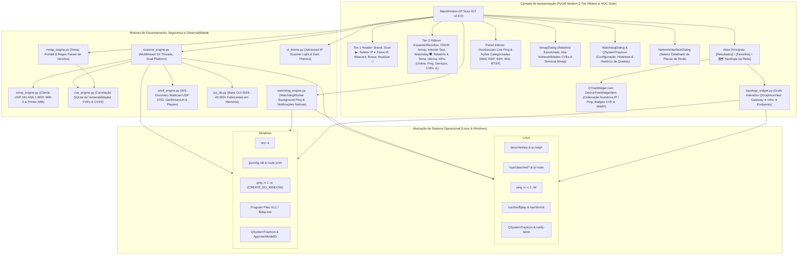

# BLUEPRINT — IP SCAN IGT
**Versão:** 2.9.0 (Edição Multiplataforma: Linux & Windows)  
**Projeto:** IP Scan IGT  
**Repositório GitHub:** [https://github.com/icarogabrielc85-ai/ip-scan-igt](https://github.com/icarogabrielc85-ai/ip-scan-igt)  
**Diretório Local (PC):** `/home/icaro/linux-ipscan`  
**Executável do Sistema (Linux):** `/home/icaro/.local/bin/ip-scan-igt`  
**Pacote Debian (.deb):** `/home/icaro/Área de trabalho/ipscan-igt_2.9.0_amd64.deb`  
**Atalho da Área de Trabalho:** `/home/icaro/Área de trabalho/ip-scan-igt.desktop`  
**Atalho do Menu do Sistema:** `~/.local/share/applications/ip-scan-igt.desktop`  
**Data da Última Atualização:** 26/10/2026  

---

## 1. Visão Geral do Produto

O **IP Scan IGT** é uma ferramenta gráfica profissional de escaneamento, auditoria e diagnóstico de redes locais (LAN) desenvolvida para ambientes **Linux** e **Windows (10/11/Server)** utilizando **Python 3** e **PyQt5**.

Inspirado na usabilidade ágil e visual clássico do consagrado *Advanced IP Scanner*, o IP Scan IGT expande essas capacidades trazendo recursos avançados nativos para ambas as plataformas:
- **Suporte Multilíngue Completo (9 Idiomas) com Tradução Dinâmica Instantânea:**
  - Português do Brasil (`pt_BR`), Inglês (`en`), Espanhol (`es`), Italiano (`it`), Ucraniano (`uk`), Russo (`ru`), Chinês Simplificado (`zh_CN`), Polonês (`pl`) e Francês (`fr`).
  - Tradução integral de resultados de varredura, classificações de dispositivos, sub-recursos filhos, painel de propriedades, osciloscópio de ping e relatórios executivos.
  - Alternância instantânea de idioma em tempo real via menu ou barra superior sem necessidade de reiniciar o programa ou refazer a varredura.
- **Auditoria de Internet & Benchmark de Servidores DNS Mundiais:**
  - Diagnóstico em tempo real de latência WAN, perda de pacotes, status do Gateway e DNS local.
  - Benchmark automatizado de provedores globais com classificação de qualidade em cores de alto contraste.
  - **Gerenciador Customizado de DNS:** Adição, edição, exclusão e restauração com persistência em `~/.config/linux-ipscan/dns_targets.json`.
  - Ordenação dinâmica (Crescente ▲ / Decrescente ▼) por milissegundos numéricos reais.
- **Abertura Inteligente Maximizada & Auto-Ajustável:**
  - Aplicação e diálogo de teste iniciam maximizados por padrão adaptados à resolução nativa do monitor.
  - Ao desmaximizar (restaurar), a janela centraliza suavemente em 90% da resolução da tela mantendo o controle ergonômico.
  - Ping e diagnósticos no Windows executados de forma 100% oculta e silenciosa sem popups de janelas CMD.
- **Descoberta Automática de Câmeras IP & NVRs via ONVIF (WS-Discovery UDP 3702)** com extração de perfis e URI tokenizada de streaming RTSP em tempo real.
- **Reprodução Imediata de Transmissões de Vídeo ao Vivo (RTSP 554) via VLC / FFplay** com aceleração por hardware e suporte a H.264 e HEVC/H.265 (4K/5MP).
- **Auditoria via SNMP (UDP 161) em Python Puro:** Codificador/decodificador ASN.1 BER nativo (`snmp_engine.py`) para extrair descrição de hardware, hostname, uptime, número de portas de switches e nível de toner/contador de páginas impressas em impressoras de rede (Printer-MIB).
- **Correlação Automática de Vulnerabilidades (CVEs) via SQLite Local:** Cruza banners HTTP/SSH/SSL/SNMP, modelos ONVIF, portas críticas expostas e versões do Nmap com uma base curada SQLite (`cve_knowledge.db`), destacando dispositivos em risco com score CVSS e orientações de mitigação.
- **Monitoramento Contínuo em Segundo Plano (Watchdog):** Vigia 24/7 os ativos da aba Favoritos com histerese configurável de falhas, emitindo notificações nativas no desktop (`QSystemTrayIcon` e `notify-send`) em caso de queda ou recuperação e registrando histórico persistente de incidentes.
- **Mapeamento Visual Interativo de Topologia (NOC Graph):** Grafo interativo (`QGraphicsView`/`QGraphicsScene`) na 3ª aba principal ilustrando como Gateway, Switches/Proxmox/NVRs e Endpoints se interconectam, com layouts Radial e em Camadas, cores por latência, alerta visual de risco CVE e exportação PNG.
- **Network Guard (Detecção de Intrusos L2, Conflito de IP e ARP Spoofing):** Vigia os vínculos IP-MAC e o MAC do Gateway para detectar sequestro de rota (*ARP Spoofing / MitM*), troca abrupta de placa (*Conflito de IP*) e entrada de dispositivos não autorizados (*Intrusos*), com controle de Whitelist de MACs confiáveis.
- **Snapshots de Auditoria & Comparador de Mudanças (Baseline Diff):** Permite salvar fotografias completas da rede e compará-las com qualquer varredura futura, destacando em cores novos hosts (`🟢 +Novo`), servidores que sumiram (`🔴 -Ausente`) e portas/CVEs modificadas (`🟠 ~Modificado`).
- **Relatório Executivo HTML / PDF Autocontido com Topologia Embutida:** Gera laudo técnico completo com **Score de Segurança da Rede (0–100)**, **Mapa Visual de Topologia em Base64 PNG**, **Matriz de Vulnerabilidades (CVEs)** e **Telemetria de Infraestrutura SNMP/Impressoras/UPnP**.
- **Descoberta UPnP / SSDP (UDP 1900) & Traceroute Visual por Saltos (TTL):** Identifica modelo exato, fabricante e número de série de Smart TVs, roteadores Mesh e IoT via XML UPnP, além de rastrear visualmente cada salto (hop) de rota com grafo de latência.
- **Integração Total com Nmap** operando em espaço de usuário (*user-space* sem necessidade de `sudo` no Linux e detecção automática no Windows).
- **Osciloscópio de Ping Instantâneo Dinâmico** com gráfico em tempo real e resolução sub-milissegundo.
- **Compilação e Empacotamento Automatizado Multiplataforma:**
  - Pacote Debian `.deb` oficial para Ubuntu, Debian, Mint e Pop!_OS.
  - Instalador Assistente `.exe` (Inno Setup) e Pacote corporativo `.msi` (WiX) para Windows.
  - Executável portátil standalone `.exe` sem dependências para Windows.

---

## 2. Diagrama de Arquitetura do Sistema



---

## 3. Módulos e Estrutura de Arquivos

| Arquivo / Caminho | Responsabilidade / Função |
| :--- | :--- |
| [`main.py`](file:///home/icaro/linux-ipscan/main.py) | Ponto de entrada da aplicação, janela principal (`MainWindow`), ciclo de vida de threads (`ScanWorker`, `LivePingWorker`), menu bar, atalhos, exportação de relatórios (CSV, JSON, TXT), registro de AppID no Windows e persistência de Favoritos. |
| [`scanner_engine.py`](file:///home/icaro/linux-ipscan/scanner_engine.py) | Motor de varredura multithread (ThreadPoolExecutor). Abstração multiplataforma para ping com sub-milissegundo (Linux e Windows), tabela ARP (`/proc/net/arp` e `arp -a`), enumeração de placas (`iproute2` e `ipconfig`), banners HTTP/SSH, inspeção de certificados SSL em Python puro (`ssl.get_server_certificate`), classificação automática de SO e gateways padrão. |
| [`onvif_engine.py`](file:///home/icaro/linux-ipscan/onvif_engine.py) | Motor de descoberta ONVIF via WS-Discovery multicast (`239.255.255.250:3702`), decodificador de scopes XML, resolução de token RTSP dinâmico via `GetStreamUri` (suporte a Xiongmai XM530, Hikvision, Dahua, Intelbras), probe RTSP (554) e detecção/disparo automático de players de vídeo (FFplay / VLC) em Linux e Windows. |
| [`nmap_engine.py`](file:///home/icaro/linux-ipscan/nmap_engine.py) | Wrapper portável para execução assíncrona do Nmap sem privilégios de root (`-sT`), streaming de saída linha a linha (`NmapScannerThread`), parser regex de portas/serviços/versões, detecção automática do `nmap.exe` no Windows e gerador de diagnóstico inteligente de dispositivos. |
| [`nmap_dialog.py`](file:///home/icaro/linux-ipscan/nmap_dialog.py) | Interface moderna de auditoria do Nmap (`NmapDialog`) com abas divididas entre **Relatório Estruturado**, **Vulnerabilidades (CVEs)** e **Terminal Nmap**. |
| [`snmp_engine.py`](file:///home/icaro/linux-ipscan/snmp_engine.py) | Motor SNMPv1/v2c (UDP 161) em Python puro (ASN.1 BER) para extração de `sysDescr`, `sysName`, `sysUpTime`, contagem de interfaces de switches e níveis de toner/páginas em impressoras (Printer-MIB). |
| [`cve_engine.py`](file:///home/icaro/linux-ipscan/cve_engine.py) | Motor de correlação de vulnerabilidades (CVEs) com banco SQLite local (`cve_knowledge.db`), cruzando banners HTTP/SSH/SSL/SNMP, portas expostas e versões do Nmap com cálculo de risco CVSS e recomendações de mitigação. |
| [`watchdog_engine.py`](file:///home/icaro/linux-ipscan/watchdog_engine.py) | Motor de monitoramento contínuo em segundo plano (`WatchdogWorker` + `WatchdogDialog`) para os dispositivos em Favoritos com histerese de falhas, notificações nativas no desktop (`QSystemTrayIcon` / `notify-send`) e histórico persistente de incidentes. |
| [`topology_widget.py`](file:///home/icaro/linux-ipscan/topology_widget.py) | Grafo visual interativo de topologia de rede (`NetworkTopologyWidget` via `QGraphicsView`/`QGraphicsScene`) conectando Gateway, Switches/Hipervisores/NVRs e Endpoints com zoom, arraste, filtro por risco, barra deslizante de espaçamento/densidade de nós (50% a 300%) e exportação PNG / Base64. |
| [`network_guard_engine.py`](file:///home/icaro/linux-ipscan/network_guard_engine.py) | Motor de segurança L2 (`NetworkGuardEngine` + `NetworkGuardDialog`) para detecção de ataques de **ARP Spoofing** (sequestro de MAC do Gateway), **Conflito de IP** (troca de placa) e **Novos Dispositivos Intrusos**, com Whitelist de MACs confiáveis. |
| [`snapshot_engine.py`](file:///home/icaro/linux-ipscan/snapshot_engine.py) | Motor de **Snapshots de Auditoria & Comparador de Mudanças (Baseline Diff)** (`SnapshotManager` + `SnapshotDiffDialog`), destacando novos hosts (`🟢`), servidores ausentes (`🔴`) e portas/CVEs/MAC modificados (`🟠`). |
| [`upnp_engine.py`](file:///home/icaro/linux-ipscan/upnp_engine.py) | Descoberta multicast e unicast **UPnP / SSDP (UDP 1900)** com parser de XML RootDevice para extrair fabricante, modelo exato e número de série de Smart TVs, roteadores Wi-Fi Mesh, Chromecasts e IoT. |
| [`traceroute_dialog.py`](file:///home/icaro/linux-ipscan/traceroute_dialog.py) | Ferramenta gráfica de **Traceroute Visual por Saltos (TTL)** (`TracerouteWorker` + `TracerouteDialog`) com grafo encadeado de roteadores intermediários e diagnóstico de latência por salto. |
| [`interface_dialog.py`](file:///home/icaro/linux-ipscan/interface_dialog.py) | Janela modal de seleção de placas de rede (`NetworkInterfaceDialog`), listando adaptadores físicos, Wi-Fi, VPNs e bridges com IP, CIDR, faixa calculada, MAC, Gateway e velocidade de link. |
| [`oui_db.py`](file:///home/icaro/linux-ipscan/oui_db.py) | Mecanismo de resolução OUI (Organizationally Unique Identifier) com suporte a pacotes congelados PyInstaller (`sys._MEIPASS`) para tradução instantânea de MACs para nomes de fabricantes. |
| [`mac-vendors.txt`](file:///home/icaro/linux-ipscan/mac-vendors.txt) | Base de dados offline contendo mais de 40.000 prefixos MAC catalogados pela IEEE. |
| [`ui_theme.py`](file:///home/icaro/linux-ipscan/ui_theme.py) | Folhas de estilo QSS (Light Theme idêntico ao Advanced IP Scanner e Dark Theme moderno), além da implementação do componente gráfico de osciloscópio (`LivePingOscilloscope`). |
| [`icon.png`](file:///home/icaro/linux-ipscan/icon.png) | Ícone oficial PNG em alta resolução. |
| [`icon.ico`](file:///home/icaro/linux-ipscan/icon.ico) | Ícone oficial multi-resolução para Windows (16x16 até 256x256). |
| [`build_windows.bat`](file:///home/icaro/linux-ipscan/build_windows.bat) | Script em lote de 1 clique para compilação do executável portátil `dist\IPScanIGT.exe` no Windows. |
| [`build_linux.sh`](file:///home/icaro/linux-ipscan/build_linux.sh) | Script em lote para compilação do binário portátil `dist/IPScanIGT` no Linux. |
| [`ipscan_windows.spec`](file:///home/icaro/linux-ipscan/ipscan_windows.spec) | Arquivo de especificação do PyInstaller para empacotar a versão Windows sem console e com ícones. |
| [`ipscan_linux.spec`](file:///home/icaro/linux-ipscan/ipscan_linux.spec) | Arquivo de especificação do PyInstaller para empacotar o executável Linux autônomo. |
| [`.github/workflows/build.yml`](file:///home/icaro/linux-ipscan/.github/workflows/build.yml) | Automação de CI/CD que compila executáveis oficiais de Linux e Windows na nuvem a cada `git push`. |
| `~/.local/bin/ip-scan-igt` | Shell script wrapper que resolve `DISPLAY`, `XAUTHORITY` dinâmico e executa o aplicativo em qualquer sessão gráfica. |
| `~/Área de trabalho/ip-scan-igt.desktop` | Atalho da Área de Trabalho com permissão de execução liberada no desktop. |
| `~/.local/share/applications/ip-scan-igt.desktop` | Arquivo `.desktop` padrão FreeDesktop para integração com KDE Plasma, GNOME, XFCE e menus de aplicativos do sistema. |

---

## 4. Protocolos e Técnicas de Descoberta

### 4.1. Camada de Sondagem de Presença (Host Alive)
1. **Sondagem ICMP / TCP Syn-Connect:**
   - Linux: `ping -n -c 1 -W <sec> <ip>`.
   - Windows: `ping -n 1 -w <ms> <ip>` com flag de processo oculto (`CREATE_NO_WINDOW = 0x08000000`).
   - Medição de latência com precisão de microssegundos via `time.perf_counter()`.
2. **Resolução de Hardware ARP em Camada 2:**
   - Linux: leitura direta de `/proc/net/arp` e `ip neigh show`.
   - Windows: leitura via `arp -a` com normalização de formatos de hífens para dois-pontos.
   - Garante **zero falsos negativos** mesmo para dispositivos que silenciam ping ICMP.

### 4.2. Descoberta de Nomes e Serviços
- **NetBIOS Name Service (UDP 137):** Envio de query de status de nó (`CKAAAAAAAAAAAAAAAAAAAAAAAAAAAAAA`) para extrair nome da estação e grupo de trabalho/domínio Windows.
- **mDNS / Bonjour (UDP 5353) & LLMNR (UDP 5355):** Resolução de nomes locais para dispositivos Apple, Linux, impressoras e Smart TVs.
- **SMB2 / NTLMSSP Negotiate (TCP 445):** Extração de nomes DNS completos e domínio corporativo sem necessidade de autenticação.
- **Banners HTTP / HTTPS (TCP 80, 443, 8080, 8443, 8006):** Obtenção de títulos HTML e cabeçalhos `Server`.
- **Inspeção de Certificados SSL/TLS (TCP 443, 8443, 8006):** Decodificação nativa em Python via `ssl` (extração de CommonName e Subject Alternative Name DNS) sem dependência de utilitários externos.
- **Banner SSH (TCP 22):** Identificação exata da distribuição Linux (ex: `OpenSSH_8.9p1 Ubuntu`).

### 4.3. Câmeras de Segurança e Gravadores (ONVIF & RTSP)
- **WS-Discovery Multicast (UDP 3702 para 239.255.255.250):** Probe SOAP com tipo `dn:NetworkVideoTransmitter`.
- **Parsing de Scopes & Media Service (`GetStreamUri`):** Extração de Fabricante, Modelo de Hardware, Nome da Câmera e resolução dinâmica do URI exato de streaming RTSP via SOAP (`GetProfiles` e `GetStreamUri`), resolvendo autenticação de sessão e caminhos específicos de fabricantes (ex: Xiongmai XM530, Hikvision, Dahua, Intelbras).
- **Verificação e Reprodução RTSP (TCP 554):** Handshake `OPTIONS rtsp://...` com envio de User-Agent `IPScanIGT`. Execução instantânea com baixa latência via FFplay (`-rtsp_transport tcp`) com suporte total a streams 1080p H.264 e 5MP HEVC/H.265, com fallback para VLC player em Linux e Windows.

### 4.4. Auditoria Nmap em Espaço de Usuário
- Linux: Executável Nmap 7.94 com carregamento de bibliotecas dinâmicas via `LD_LIBRARY_PATH` próprio e `NMAPDIR`.
- Windows: Detecção automática da instalação padrão do Nmap (`C:\Program Files (x86)\Nmap\nmap.exe` e `PATH`).
- Perfis de escaneamento sem privilégios de root (`-sT` TCP Connect), permitindo auditoria profunda de portas altas, serviços e versões sem exigir senha de administrador.

### 4.5. Auditoria de Infraestrutura via SNMP (UDP 161)
- Implementação **100% Python puro** com codificação e decodificação ASN.1 BER (`SNMPv2c` / `SNMPv1` `GetRequest`), sem necessidade de bibliotecas C externas.
- **MIB-II (`1.3.6.1.2.1.1.*` e `1.3.6.1.2.1.2.1.0`):** Extração de `sysDescr` (modelo/OS de roteador ou switch), `sysUpTime` formatado em dias/horas/minutos, `sysName`, `sysLocation` e contagem de interfaces de rede (`ifNumber`) para identificar switches gerenciáveis.
- **Printer-MIB (`1.3.6.1.2.1.43.*`):** Consulta automática de `prtMarkerLifeCount` (contador total de páginas impressas) e cálculo percentual do nível de suprimento/toner (`prtMarkerSuppliesLevel` / `prtMarkerSuppliesMaxCapacity`).

### 4.6. Correlação de Vulnerabilidades (CVEs via SQLite)
- Base de conhecimento local em SQLite (`~/.config/linux-ipscan/cve_knowledge.db`) inicializada automaticamente pelo módulo [`cve_engine.py`](file:///home/icaro/linux-ipscan/cve_engine.py).
- Cruza expressões regulares e faixas SemVer (`version_min`..`version_max`) contra banners HTTP, SSH, SMB, SSL, SNMP (`public` exposto), portas legadas de alto risco (Telnet 23, FTP 21, RDP 3389) e a saída detalhada de versões do Nmap (`-sV`).
- Classifica vulnerabilidades por severidade (**CRITICAL**, **HIGH**, **MEDIUM**) com pontuação CVSS, destacando em vermelho/laranja os hosts vulneráveis na árvore principal e exibindo um painel dedicado de CVEs na janela do Nmap.

### 4.7. Monitoramento Contínuo em Segundo Plano (Watchdog)
- Motor assíncrono [`WatchdogWorker`](file:///home/icaro/linux-ipscan/watchdog_engine.py) (`QThread`) que monitora periodicamente os dispositivos salvos na aba **Favoritos** usando o motor de ping silencioso.
- **Histerese de Falhas:** Só dispara alerta de *Host Down* após atingir o limiar configurável de falhas consecutivas (padrão: 2 falhas), evitando falsos positivos por perda isolada de pacote.
- **Notificações Desktop & Log Persistente:** Emite alertas nativos via `QSystemTrayIcon.showMessage()` e `notify-send` (Linux) tanto na queda quanto na recuperação (*Host Recovered*), gravando o histórico de incidentes em `~/.config/linux-ipscan/watchdog_events.json`.

### 4.8. Mapeamento Visual de Topologia (Grafo NOC Interativo)
- Renderização vetorial via `QGraphicsView` / `QGraphicsScene` ([`NetworkTopologyWidget`](file:///home/icaro/linux-ipscan/topology_widget.py)) integrada diretamente como a 3ª aba principal (**`🗺️ Topologia da Rede`**).
- Descoberta automática do **Default Gateway** local (`/proc/net/route`, `ip route` ou `route print`) posicionado como nó central da topologia.
- **Inferência Inteligente de Enlaces:** Conecta automaticamente VMs ao hipervisor Proxmox da rede, câmeras IP ao NVR/Gravador correspondente e demais estações aos Switches gerenciáveis ou ao Gateway principal.
- **Modos Radial (NOC) e Hierárquico (Camadas):** Nós arrastáveis, zoom suave via roda do mouse, links coloridos pela latência de ping (`<5ms` verde, `5-30ms` azul, `>30ms` âmbar), halos pulsantes de alerta para hosts com CVEs críticas e exportação direta do mapa para imagem **PNG** e **Base64**.

### 4.9. Network Guard — Detecção de Intrusos, Conflito de IP e ARP Spoofing
- Monitoramento em Camada 2 ([`network_guard_engine.py`](file:///home/icaro/linux-ipscan/network_guard_engine.py)) com persistência em `~/.config/linux-ipscan/network_guard.json`.
- **ARP Spoofing (`CRITICAL`):** Alerta imediatamente se o MAC do Gateway padrão mudar ou se outro endereço IP na rede passar a anunciar o mesmo endereço MAC físico do Gateway.
- **Conflito de IP (`HIGH`):** Detecta quando um endereço IP ativo na sub-rede muda abruptamente de endereço MAC físico.
- **Novos Dispositivos / Intrusos (`WARNING`):** Identifica placas de rede inéditas que ainda não constam na Whitelist de MACs confiáveis aprovados pelo administrador.

### 4.10. Snapshots de Auditoria & Comparador de Mudanças (Baseline Diff)
- Armazenamento de fotografias completas da rede ([`snapshot_engine.py`](file:///home/icaro/linux-ipscan/snapshot_engine.py)) em `~/.config/linux-ipscan/snapshots.json`.
- Algoritmo de comparação estrutural (`compare_host_maps`) que cruza qualquer Snapshot Base com a varredura ao vivo, classificando:
  - 🟢 **Novos Hosts (`ADDED`):** Dispositivos que entraram na rede desde a última auditoria;
  - 🔴 **Hosts Ausentes (`REMOVED`):** Servidores ou equipamentos que saíram da rede;
  - 🟠 **Hosts Modificados (`MODIFIED`):** Alterações exatas de portas TCP (`+Portas Abertas`, `-Portas Fechadas`), novas CVEs (`+Novas CVEs`), troca de MAC ou mudança de Hostname.

### 4.11. Relatório Executivo de Auditoria HTML / PDF Autocontido
- Gerador de laudo executivo e técnico (`generate_executive_html_report` em [`main.py`](file:///home/icaro/linux-ipscan/main.py)) pronto para impressão nativa em PDF (`window.print()`).
- Inclui **Score de Segurança da Rede (0–100 e Conceito A–F)**, **Mapa Visual de Topologia da Rede embutido em Base64 PNG**, **Matriz Completa de Vulnerabilidades (CVEs)** com CVSS e mitigação, e tabela dedicada de **Infraestrutura SNMP, Impressoras e UPnP**.

### 4.12. Descoberta UPnP / SSDP (UDP 1900) & Traceroute Visual
- **SSDP Multicast & Unicast ([`upnp_engine.py`](file:///home/icaro/linux-ipscan/upnp_engine.py)):** Envia pacotes `M-SEARCH` para `239.255.255.250:1900`, coleta o header `LOCATION` e faz o parse do XML UPnP (`friendlyName`, `manufacturer`, `modelName`, `serialNumber`, `presentationURL`).
- **Traceroute Visual ([`traceroute_dialog.py`](file:///home/icaro/linux-ipscan/traceroute_dialog.py)):** Sondagem iterativa salto a salto (`TTL 1..30`) compatível com Linux e Windows sem exigir privilégios de root, desenhando um grafo encadeado de roteadores com código de cores por latência RTT.

---

## 5. UI/UX Design System e Regras de Interface

1. **Aparência e Fidelidade Visual:**
   - Barra de ferramentas clássica superior com botão verde vibrante `▶  Verificar`, botão seletor de sub-rede `IP ▾`, campos de faixa de IP, seletor de máscara (`/24`, `/16`, etc.) e botão de monitoramento `🛡️ Watchdog`.
   - Abas principais de largura total: **[Resultados]**, **[Favoritos]** e **[🗺️ Topologia da Rede]**.
2. **Classificação Dinâmica Inteligente ([`DeviceTreeWidgetItem`](file:///home/icaro/linux-ipscan/main.py)):**
   - **IP (Col 2):** Ordenação numérica por octetos `(192, 168, 111, 1)` em vez de texto bruto.
   - **Ping (Col 5):** Ordenação por milissegundos numéricos; estações offline são empurradas para o final no modo crescente.
   - **Nome / Fabricante / MAC:** Ordenação alfabética case-insensitive.
   - **Status (Col 0):** Dispositivos online (`●`) ordenados prioritariamente.
   - Indicador visual nativo com setas **▲ / ▼** no cabeçalho e feedback textual na barra de status.
3. **Hierarquia, Segurança e Limpeza Visual:**
   - Itens de dispositivos mantêm-se **recolhidos por padrão**, apresentando uma linha limpa por host online.
   - Dispositivos com CVEs detectadas exibem badge `[⚠️ N CVE]` e coloração semântica de risco (vermelho para `CRITICAL`/`HIGH`, laranja para `MEDIUM`).
   - Sub-recursos `[+]` agrupam portas, serviços web/vídeo, telemetria SNMP (uptime, portas, toner/páginas) e alertas de CVE sem quebrar a visualização principal.
4. **Osciloscópio de Ping em Tempo Real ([`LivePingOscilloscope`](file:///home/icaro/linux-ipscan/ui_theme.py)):**
   - Gráfico de onda contínua atualizado a cada 500ms para o dispositivo selecionado, com histórico dos últimos 60 pings, média, pico e indicação de perda de pacotes.

---

## 6. Comandos e Guia de Execução

### Como iniciar o aplicativo no Linux:
- **Pela Área de Trabalho:** Duplo-clique no ícone **IP Scan IGT** na Área de Trabalho.
- **Pelo Menu do Sistema:** Pesquise por `IP Scan IGT`.
- **Pelo Terminal:**
  ```bash
  ip-scan-igt
  ```

### Como compilar e executar no Windows:
- **Compilação em 1 clique:** Duplo clique em `build_windows.bat`.
- **Execução:** Executar `dist\IPScanIGT.exe`.

### Atalhos de Teclado Globais:
- **`F5`**: Iniciar / Parar Varredura de Rede
- **`Esc`**: Parar Varredura Ativa
- **`Ctrl + N`**: Abrir Console de Varredura Nmap
- **`Ctrl + I`**: Abrir Seletor de Placas de Rede
- **`Ctrl + E`**: Expandir Todos os Serviços `[+]`
- **`Ctrl + R`**: Recolher Todos os Dispositivos `[-]`
- **`Ctrl + D`**: Adicionar Dispositivo Selecionado aos Favoritos
- **`Ctrl + P`**: Exibir / Ocultar Painel Inferior de Osciloscópio
- **`Ctrl + T`**: Alternar Tema Claro / Escuro
- **`Ctrl + S`**: Exportar Resultados para CSV
- **`Ctrl + Q`**: Sair do Aplicativo

---
*Blueprint oficial v2.9.0 aprovado e sincronizado com o repositório do projeto IP Scan IGT.*
