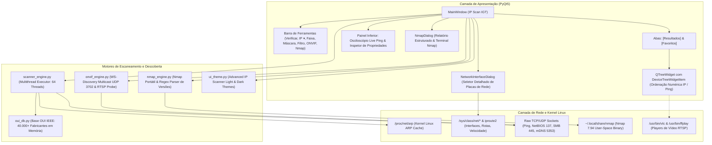

# BLUEPRINT — IP SCAN IGT
**Versão:** 2.0.0 (Edição Nativa Linux)  
**Projeto:** IP Scan IGT  
**Repositório / Diretório Local:** `/home/icaro/linux-ipscan`  
**Executável do Sistema:** `/home/icaro/.local/bin/ip-scan-igt`  
**Atalho Desktop:** `~/.local/share/applications/ip-scan-igt.desktop`  
**Data de Criação:** 20/10/2026  

---

## 1. Visão Geral do Produto

O **IP Scan IGT** é uma ferramenta gráfica profissional de escaneamento, auditoria e diagnóstico de redes locais (LAN) desenvolvida especificamente para ambientes **Linux** utilizando **Python 3** e **PyQt5**.

Inspirado na usabilidade ágil e visual clássico do consagrado *Advanced IP Scanner*, o IP Scan IGT expande essas capacidades trazendo recursos avançados nativos para o ecossistema Linux:
- **Descoberta Automática de Câmeras IP & NVRs via ONVIF (WS-Discovery UDP 3702)**.
- **Reprodução Imediata de Transmissões de Vídeo ao Vivo (RTSP 554) via VLC / FFplay**.
- **Integração Total com Nmap Portátil** operando em espaço de usuário (*user-space* sem necessidade de `sudo`).
- **Osciloscópio de Ping Instantâneo Dinâmico** com gráfico em tempo real e resolução sub-milissegundo.
- **Classificação Dinâmica Inteligente em 1 Clique** (Crescente ▲ / Decrescente ▼) por IP numérico real, Nome, Latência, MAC e Fabricante.
- **Seletor de Placas de Rede** com preenchimento automático para interfaces cabeadas (Ethernet), Wi-Fi, VPNs (WireGuard/OpenVPN) e Bridges virtuais (Docker/KVM).

---

## 2. Diagrama de Arquitetura do Sistema



---

## 3. Módulos e Estrutura de Arquivos

| Arquivo / Caminho | Responsabilidade / Função |
| :--- | :--- |
| [`main.py`](file:///home/icaro/linux-ipscan/main.py) | Ponto de entrada da aplicação, janela principal (`MainWindow`), ciclo de vida de threads (`ScanWorker`, `LivePingWorker`), menu bar, atalhos, exportação de relatórios (CSV, JSON, TXT) e persistência de Favoritos. |
| [`scanner_engine.py`](file:///home/icaro/linux-ipscan/scanner_engine.py) | Motor de varredura multithread (ThreadPoolExecutor). Implementa sondagem de ping com sub-milissegundo, varredura rápida de portas TCP, resolução NetBIOS, mDNS, LLMNR, NTLMSSP de SMB2, banners HTTP/SSL/SSH, classificação automática de SO e enumeração de interfaces de rede. |
| [`onvif_engine.py`](file:///home/icaro/linux-ipscan/onvif_engine.py) | Motor de descoberta ONVIF via WS-Discovery multicast (`239.255.255.250:3702`), decodificador de scopes XML (marca, modelo, hardware, localização), probes unicast SOAP e validação de stream RTSP na porta 554. |
| [`nmap_engine.py`](file:///home/icaro/linux-ipscan/nmap_engine.py) | Wrapper portável para execução assíncrona do Nmap sem privilégios de root (`-sT`), streaming de saída linha a linha (`NmapScannerThread`), parser regex de portas/serviços/versões e gerador inteligente de diagnósticos em linguagem natural. |
| [`nmap_dialog.py`](file:///home/icaro/linux-ipscan/nmap_dialog.py) | Interface moderna de auditoria do Nmap (`NmapDialog`) com abas divididas entre **Relatório Estruturado** (cards informativos, badges de métricas, tabela com botões de ação direta) e **Terminal Nmap** (saída bruta para auditoria técnica). |
| [`interface_dialog.py`](file:///home/icaro/linux-ipscan/interface_dialog.py) | Janela modal de seleção de placas de rede (`NetworkInterfaceDialog`), listando adaptadores físicos, Wi-Fi, VPNs e bridges com IP, CIDR, faixa calculada, MAC, Gateway e velocidade de link. |
| [`oui_db.py`](file:///home/icaro/linux-ipscan/oui_db.py) | Mecanismo de resolução OUI (Organizationally Unique Identifier) com índice em memória para tradução instantânea de MACs para nomes de fabricantes. |
| [`mac-vendors.txt`](file:///home/icaro/linux-ipscan/mac-vendors.txt) | Base de dados offline contendo mais de 40.000 prefixos MAC catalogados pela IEEE. |
| [`ui_theme.py`](file:///home/icaro/linux-ipscan/ui_theme.py) | Folhas de estilo QSS (Light Theme idêntico ao Advanced IP Scanner e Dark Theme moderno), além da implementação do componente gráfico de osciloscópio (`LivePingOscilloscope`). |
| [`icon.png`](file:///home/icaro/linux-ipscan/icon.png) | Ícone de alta resolução do aplicativo. |
| `~/.local/bin/ip-scan-igt` | Shell script wrapper que resolve `DISPLAY`, `XAUTHORITY` dinâmico e executa o aplicativo em qualquer sessão gráfica. |
| `~/.local/share/applications/ip-scan-igt.desktop` | Arquivo `.desktop` padrão FreeDesktop para integração com KDE Plasma, GNOME, XFCE e menus de aplicativos do sistema. |

---

## 4. Protocolos e Técnicas de Descoberta

### 4.1. Camada de Sondagem de Presença (Host Alive)
1. **Sondagem ICMP / TCP Syn-Connect:**
   - Disparo rápido com timeout configurável (300ms a 550ms) medindo latência com precisão de microssegundos via `time.perf_counter()`.
2. **Resolução de Hardware ARP em Camada 2 (Kernel Linux):**
   - Leitura direta da tabela ARP do kernel em `/proc/net/arp`. Dispositivos na LAN que bloqueiam pacotes de ping ICMP respondem à resolução ARP em nível de enlace, garantindo **zero falsos negativos**.

### 4.2. Descoberta de Nomes e Serviços
- **NetBIOS Name Service (UDP 137):** Envio de query de status de nó (`CKAAAAAAAAAAAAAAAAAAAAAAAAAAAAAA`) para extrair nome da estação e grupo de trabalho/domínio Windows.
- **mDNS / Bonjour (UDP 5353) & LLMNR (UDP 5355):** Resolução de nomes locais para dispositivos Apple, Linux, impressoras e Smart TVs.
- **SMB2 / NTLMSSP Negotiate (TCP 445):** Extração de nomes DNS completos e domínio corporativo sem necessidade de autenticação.
- **Banners HTTP / HTTPS (TCP 80, 443, 8080, 8443, 8006):** Obtenção de títulos HTML, cabeçalhos `Server` e Common Name (CN) de certificados SSL/TLS.
- **Banner SSH (TCP 22):** Identificação exata da distribuição Linux (ex: `OpenSSH_8.9p1 Ubuntu`).

### 4.3. Câmeras de Segurança e Gravadores (ONVIF & RTSP)
- **WS-Discovery Multicast (UDP 3702 para 239.255.255.250):** Probe SOAP com tipo `dn:NetworkVideoTransmitter`.
- **Parsing de Scopes & Media Service (`GetStreamUri`):** Extração de Fabricante, Modelo de Hardware, Nome da Câmera e resolução dinâmica do URI exato de streaming RTSP via SOAP (`GetProfiles` e `GetStreamUri`), resolvendo autenticação de sessão e caminhos específicos de fabricantes (ex: Xiongmai XM530, Hikvision, Dahua, Intelbras).
- **Verificação e Reprodução RTSP (TCP 554):** Handshake `OPTIONS rtsp://...` com envio de User-Agent `IPScanIGT`. Execução instantânea com baixa latência via FFplay (`-rtsp_transport tcp`) com suporte total a streams 1080p H.264 e 5MP HEVC/H.265, com fallback para VLC player.

### 4.4. Auditoria Nmap em Espaço de Usuário
- Executável Nmap 7.94 com carregamento de bibliotecas dinâmicas via `LD_LIBRARY_PATH` próprio e `NMAPDIR`.
- Perfis de escaneamento sem privilégios de root (`-sT` TCP Connect), permitindo auditoria profunda de portas altas, serviços e versões sem exigir senha de administrador.

---

## 5. UI/UX Design System e Regras de Interface

1. **Aparência e Fidelidade Visual:**
   - Barra de ferramentas clássica superior com botão verde vibrante `▶  Verificar`, botão seletor de sub-rede `IP ▾`, campos de faixa de IP e seletor de máscara (`/24`, `/16`, etc.).
   - Abas principais de largura total: **[Resultados]** e **[Favoritos]**.
2. **Classificação Dinâmica Inteligente ([`DeviceTreeWidgetItem`](file:///home/icaro/linux-ipscan/main.py)):**
   - **IP (Col 2):** Ordenação numérica por octetos `(192, 168, 111, 1)` em vez de texto bruto.
   - **Ping (Col 5):** Ordenação por milissegundos numéricos; estações offline são empurradas para o final no modo crescente.
   - **Nome / Fabricante / MAC:** Ordenação alfabética case-insensitive.
   - **Status (Col 0):** Dispositivos online (`●`) ordenados prioritariamente.
   - Indicador visual nativo com setas **▲ / ▼** no cabeçalho e feedback textual na barra de status.
3. **Hierarquia e Limpeza Visual:**
   - Itens de dispositivos mantêm-se **recolhidos por padrão**, apresentando uma linha limpa por host online.
   - Sub-recursos `[+]` agrupam portas e serviços web/vídeo sem quebrar a visualização principal.
4. **Osciloscópio de Ping em Tempo Real ([`LivePingOscilloscope`](file:///home/icaro/linux-ipscan/ui_theme.py)):**
   - Gráfico de onda contínua atualizado a cada 500ms para o dispositivo selecionado, com histórico dos últimos 60 pings, média, pico e indicação de perda de pacotes.

---

## 6. Comandos e Guia de Execução

### Como iniciar o aplicativo via Terminal:
```bash
ip-scan-igt
```
*Ou usando o atalho legado:*
```bash
linux-ipscan
```

### Como executar diretamente com Python:
```bash
python3 /home/icaro/linux-ipscan/main.py
```

### Atalhos de Teclado Globais:
- **`F5`**: Iniciar / Parar Varredura de Rede
- **`Esc`**: Parar Varredura Ativa
- **`Ctrl + N`**: Abrir Console de Varredura Nmap
- **`Ctrl + I`**: Abrir Seletor de Placas de Rede
- **`Ctrl + E`**: Expandir Todos os Serviços `[+]`
- **`Ctrl + R`**: Recolher Todos os Dispositivos `[-]`
- **`Ctrl + D`**: Adicionar Dispositivo Selecionado aos Favoritos
- **`Ctrl + P`**: Exibir / Ocultar Painel Inferior de Osciloscópio
- **`Ctrl + T`**: Alternar Tema Claro / Escuro
- **`Ctrl + S`**: Exportar Resultados para CSV
- **`Ctrl + Q`**: Sair do Aplicativo

---
*Blueprint oficial aprovado e registrado para o projeto IP Scan IGT.*
